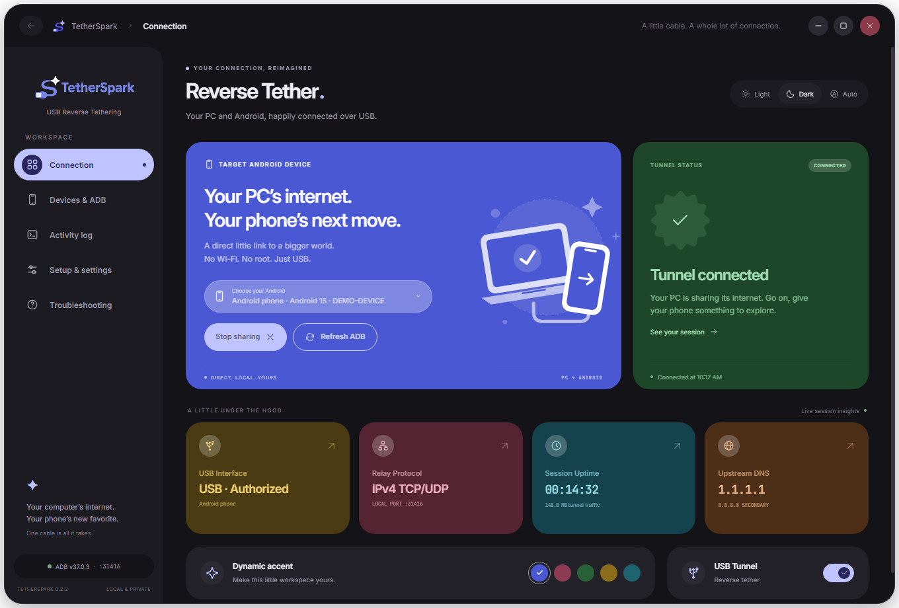
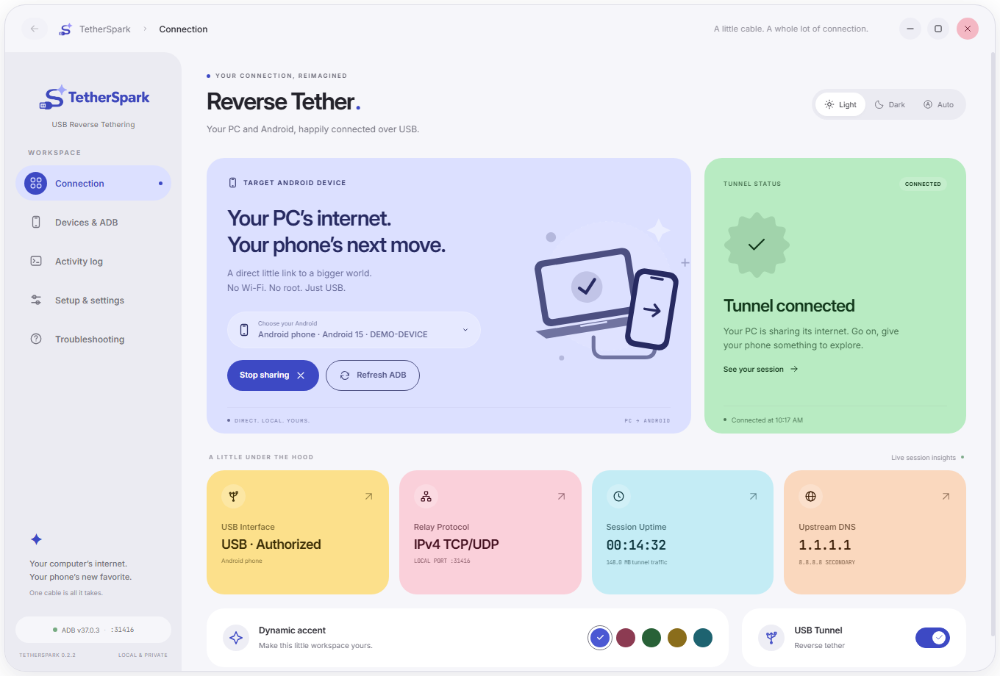
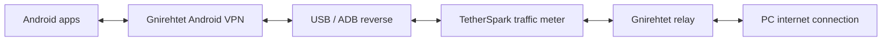

<p align="center">
  
</p>

<h1 align="center">TetherSpark</h1>

<p align="center">
  <strong>Your PC’s internet. One USB cable away.</strong>
</p>

<p align="center">
  
  
  
  <a href="LICENSE"></a>
</p>

TetherSpark shares your **Windows PC’s internet connection with an Android phone over USB**. It brings device discovery, connection controls, live session information, and troubleshooting into a customizable desktop interface.

Built with **Electron**, **Android Debug Bridge (ADB)**, and **[Gnirehtet](https://github.com/Genymobile/gnirehtet)**. No root access is required.

[Design](#desktop-design) · [Features](#features) · [Getting started](#getting-started) · [Build](#build-a-portable-windows-app) · [Troubleshooting](#troubleshooting) · [License](#license)

## Desktop design

TetherSpark uses a rounded, Material You inspired interface with a tonal dashboard and a compact navigation sidebar.

**Updated in version 0.2.2:** the sidebar search field has been removed, the TetherSpark logo is smaller, and the spacing above navigation is tighter.

- **Compact branding** — a smaller logo and subtitle keep the sidebar balanced.
- **Direct navigation** — open Connection, Devices & ADB, Activity log, Setup & settings, or Troubleshooting from the sidebar.
- **Connection dashboard** — device selection, start/stop controls, tunnel status, USB authorization, relay details, uptime, traffic totals, and DNS information in rounded cards.
- **Personalized appearance** — light, dark, and system themes with five accent colors.

## Preview

The screenshots below show the updated **0.2.2** design, including the smaller sidebar logo and direct navigation.

### Dark theme



<details>
  <summary>View the light theme</summary>



</details>

*Screenshots show the real interface with demo device and session values. They are not performance benchmarks.*

## Features

- **One-click sharing** — start or stop the USB tunnel from the dashboard.
- **Compact sidebar** — a smaller TetherSpark logo and direct access to all five views.
- **Device discovery** — view connected Android phones, authorization states, Android versions when available, and companion installation status.
- **Live session details** — track uptime, the VPN approval countdown, DNS resolvers, and measured tunnel traffic.
- **Personalized appearance** — light, dark, and system themes; five accent colors; persistent appearance preferences.
- **Searchable activity log** — filter by severity, search events, clear the buffer, and export a `.log` file. The buffer holds the latest 300 entries.
- **Configurable tools and DNS** — choose local ADB, Gnirehtet, and APK files, plus primary and secondary IPv4 DNS resolvers.
- **Guided troubleshooting** — check USB discovery, debugging authorization, VPN state, and local port availability.
- **Windows branding** — custom window controls and a multi-size TetherSpark application icon.

## Requirements

| Component | Requirement |
| --- | --- |
| Computer | Windows 10 or 11, x64, with an internet connection |
| Phone | Android 5.0 / API 21 or newer |
| USB connection | A data-capable cable and USB debugging enabled |
| Phone permissions | Approve this computer’s debugging authorization and Android’s VPN request |
| Source development | Node.js 22.12 or newer and npm |

**Node.js is not needed to run a packaged Windows build.**

## Getting started

### Run from source

Download or clone this repository, open PowerShell in the project folder, and run:

```powershell
npm ci
npm run setup
npm start
```

`npm run setup` downloads the official Gnirehtet v2.5.1 Windows Rust release and Google’s current Android Platform Tools into `tools/`. The setup script uses Windows’ `tar.exe` to extract the archives. It does not install anything on your phone.

The first Electron launch may also download its desktop runtime. See [Third-party components](#third-party-components) for the upstream projects and license notices.

### Run a packaged build

If you have a packaged Windows archive:

1. Extract the **entire archive** to a folder.
2. Close any older TetherSpark or TetherDesk window.
3. Run `TetherSpark.exe`.

Keep the executable and its accompanying files together.

### Prepare your Android phone

1. Open **Settings → About phone** and tap **Build number** seven times to enable Developer options. Menu names vary by manufacturer.
2. Enable **USB debugging** in Developer options.
3. Connect the phone to your PC using a data-capable USB cable.
4. Unlock the phone and accept **Allow USB debugging** for this computer.
5. In TetherSpark, select your device and click **Start sharing**.
6. Approve Android’s VPN connection request. The companion app is installed if needed.

The dashboard shows **Tunnel connected** after the Android client reaches the relay. Click **Stop sharing** before unplugging the cable. Closing TetherSpark also stops its session; the companion app remains installed for later use.

### Configure tools manually

You can use your own extracted tool copies instead of automatic setup:

| Setting | File to select |
| --- | --- |
| Android Debug Bridge | `adb.exe` from [Android Platform Tools](https://developer.android.com/tools/releases/platform-tools) |
| Gnirehtet relay | `gnirehtet.exe` from the [Windows Rust release](https://github.com/Genymobile/gnirehtet/releases/tag/v2.5.1) |
| Android companion | `gnirehtet.apk` from the same Gnirehtet archive |

Open **Setup & settings**, select the three files, enter your DNS resolvers, and save. Keep the Platform Tools files together, including `AdbWinApi.dll` and `AdbWinUsbApi.dll` beside `adb.exe`.

## How it works



TetherSpark manages the desktop tools and the Android companion. A loopback-only meter listens on port **31416** and forwards traffic to Gnirehtet on an automatically selected local port.

The traffic counter measures both directions of the actual tunnel, including protocol framing overhead. It is not an internet speed test or an application-payload counter.

### Connection limits

- The relay supports **IPv4 TCP and UDP**. IPv6 is not tunneled.
- Android normally permits **one active VPN** at a time. Stop another VPN before sharing.
- The app manages **one selected phone per session**.
- Automatic reconnection after unplugging the cable is not included in this version.
- USB generation and link speed are not guessed when ADB does not report them.
- A connected tunnel does not confirm that the PC’s upstream internet or a particular website is reachable.

To verify the USB internet path, temporarily turn off Wi-Fi and mobile data on your phone, then open a website.

## Build a portable Windows app

After installing dependencies and downloading the tools, run:

```powershell
npm run check
npm test
npm run verify:tools
npm run smoke
npm run build:icons
npm run package
npm run smoke -- --packaged
```

The current build is created at:

```text
dist/0.2.2/TetherSpark-win32-x64/TetherSpark.exe
```

The output directory follows the version in `package.json`. Packaging requires the desktop tools and their license files. Development builds are unsigned.

### Development checks

| Command | Purpose |
| --- | --- |
| `npm run check` | Check JavaScript syntax |
| `npm test` | Check connection behavior, validation, cleanup, device metadata, logs, and local byte forwarding |
| `npm run verify:tools` | Perform a local handshake with the real Gnirehtet relay through the traffic meter |
| `npm run smoke` | Check the Electron UI, themes, navigation, controls, and simulated connection states |
| `npm run build:icons` | Export the icon master into a multi-size Windows ICO |
| `npm run smoke -- --packaged` | Check the packaged UI, bundled assets, and embedded icon |

Loopback socket checks need an environment that allows local networking. UI checks use an isolated profile and simulated connection states; they do not replace testing internet sharing with an authorized phone and manual VPN approval.

## Troubleshooting

| Symptom | What to try |
| --- | --- |
| No device detected | Try another data cable or USB port. Enable USB debugging. Install your phone manufacturer’s Windows USB driver if needed. |
| Device is unauthorized | Unlock the phone and accept the debugging prompt. If it does not appear, revoke USB debugging authorizations on the phone and reconnect. |
| Device is offline | Reconnect the cable, unlock the phone, and refresh ADB. |
| Waiting for VPN approval | Approve the request on the phone. The approval window is two minutes after client startup completes. Retry if it expires. |
| Port 31416 is occupied | Close another Gnirehtet or reverse-tethering session, then retry. Check Activity log for details. |
| Connected without internet | Verify internet works on the PC, check its firewall, stop another Android VPN, and review the DNS resolvers. |
| Connection drops after unplugging | Stop sharing, reconnect the cable, and start a new session. |
| Android VPN remains active after a stop warning | Turn it off on the phone. TetherSpark still terminates its desktop relay when the phone is unreachable. |
| Opening the new build shows the old window | Close the previous version first. The app permits one normal instance at a time. |

The **Troubleshooting** view runs local checks for device discovery, authorization, VPN state, and port availability. PC internet and firewall checks remain manual.

## Settings and logs

- Settings are normally stored at `%APPDATA%/tetherdesk/settings.json`. The legacy directory name preserves compatibility with earlier TetherDesk builds.
- Session logs stay in memory until cleared or the app closes. Exporting a log writes a file you choose.
- Exported logs can contain device serial numbers and local paths; review them before sharing publicly.
- The renderer uses context isolation, sandboxing, and a restricted preload API. Tool commands use argument arrays without a command shell.

## Repository layout

```text
src/                 Electron app, connection manager, and traffic meter
src/ui/              Interface, bundled fonts, and runtime brand assets
scripts/             Setup, build, and verification utilities
tests/               Backend and loopback forwarding checks
branding/            Logo and icon masters, plus generation prompts
docs/images/         GitHub README screenshots using demo data
```

### Uploading to GitHub

Upload the source folders, `README.md`, `package.json`, `package-lock.json`, `.gitignore`, `LICENSE`, and `THIRD_PARTY_NOTICES.md`. Include **`branding/` and `docs/images/`** so the README images render.

The existing `.gitignore` excludes `node_modules/`, `tools/`, `dist/`, temporary downloads, `artifacts/`, and `.log` files. These generated files do not belong in the source repository.

For a GitHub Release, ZIP the **complete** `TetherSpark-win32-x64` build folder and attach that archive as a release asset. Retain the bundled dependency notices when distributing a build.

## Contributing

Bug reports and focused improvements are welcome. For connection problems, include the app version, Windows and Android versions, reproduction steps, and relevant log entries with personal device details removed. Run the checks relevant to your changes before proposing an update.

## Third-party components

TetherSpark is an independent desktop interface for these projects:

- [Gnirehtet](https://github.com/Genymobile/gnirehtet) — Android VPN companion and IPv4 relay, Apache License 2.0. Upstream notes that maintenance is limited.
- [Android Platform Tools](https://developer.android.com/tools/releases/platform-tools) — ADB and related desktop files, supplied by Google and the Android project.
- [Electron](https://www.electronjs.org/) — desktop runtime.
- Inter and JetBrains Mono — locally bundled fonts under the SIL Open Font License.

See [THIRD_PARTY_NOTICES.md](THIRD_PARTY_NOTICES.md) and the bundled license files for details.

## License

TetherSpark’s application code is released under the [MIT License](LICENSE). Third-party tools, fonts, and runtime components retain their respective licenses.
